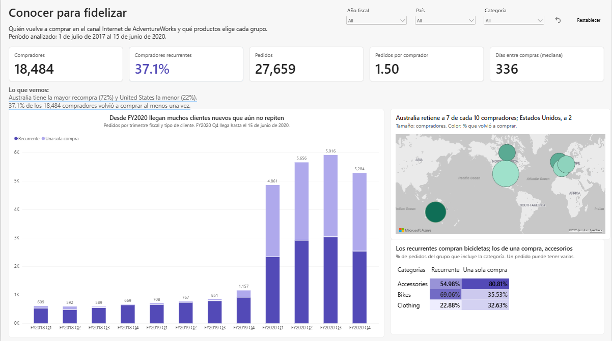
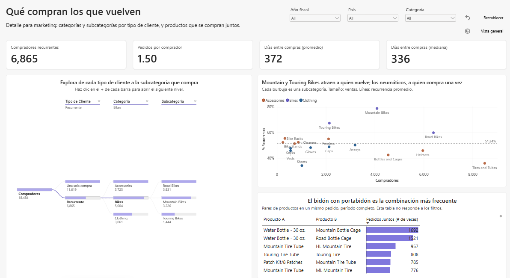

# Conocer para fidelizar: recompra de clientes en AdventureWorks

Actividad 1 de Visualización Avanzada y Automatización del Análisis de Datos, Máster Universitario en Inteligencia de Negocio (UNIR), Equipo 7 - Lote 41.

Dashboard en Power BI que analiza la recompra y las preferencias de producto de los clientes del canal Internet de AdventureWorks entre el 1 de julio de 2017 y el 15 de junio de 2020. Está pensado para la dirección comercial (página 1) y para el equipo de marketing (página 2), y cada visual lleva como título su conclusión.

## Resultados

- 6.865 de 18.484 compradores (37,1 %) hicieron dos o más pedidos; el promedio es 1,50 pedidos por comprador.
- Australia retiene al 72 % de sus compradores y Estados Unidos, que reúne el 42 % de los clientes, al 22 %.
- Entre compras pasan 336 días en la mediana (372 en promedio).
- Las bicicletas aparecen en el 69,1 % de los pedidos de clientes recurrentes y en el 35,5 % de los de una sola compra.
- El par más frecuente en un mismo pedido es Water Bottle - 30 oz. con Mountain Bottle Cage (1.692 pedidos).

## Contenido

| Carpeta | Archivo | Qué es |
|---|---|---|
| `powerbi/` | `Act1_VisualizacionAvanzada_Grupo7.pbix` | Informe de Power BI con el modelo, las medidas y las dos páginas |
| `datos/` | `AdventureWorks.xlsx` | Base de la actividad: ventas, pedidos, clientes, productos, revendedores, territorios y fechas |
| `dax/` | `medidas.dax` | Medidas DAX del dashboard, comentadas |
| `capturas/` | `pagina1_fidelizacion.png`, `pagina2_detalle_recompra.png` | Vista de las dos páginas |

## Cómo está construido

- **Power Query:** se une `Sales_data` con `Sales Order_data` por `SalesOrderLineKey` y se filtra el canal Internet (60.398 líneas). Reseller se excluye porque su cliente final figura como -1.
- **Modelo en estrella:** `Sales_data` como tabla de hechos, relacionada con clientes, productos, fechas y territorios. Las tablas `Clientes_Recurrencia` y `Productos_Comprados_Juntos` se calculan en Power Query.
- **Medidas:** todas explícitas en DAX. La medida `Pedidos históricos` quita los filtros de fecha y producto para que un cliente no cambie de tipo al filtrar un año o una categoría.
- **Visuales:** tarjetas de KPI, columnas apiladas por trimestre fiscal, mapa de Azure Maps, matriz con escala de color, árbol de descomposición, dispersión por subcategoría y tabla de pares con barras de datos.
- **Interactividad:** segmentadores sincronizados (año fiscal, país y categoría), botón para restablecer filtros con un marcador y botones de navegación entre páginas.

## Cómo usarlo

Abre el `.pbix` con Power BI Desktop actualizado (el informe usa el formato PBIR). Si Power BI no encuentra el Excel, ve a **Transform data → Data source settings → Change source** y apunta a `datos/AdventureWorks.xlsx`. Si el mapa aparece deshabilitado, activa **Use Azure Maps visual** en **File → Options and settings → Options → Security**.

## Notas

- Un cliente es recurrente si hizo dos o más pedidos dentro del período observado. Quien llegó en 2020 tuvo menos tiempo para repetir, así que una sola compra no prueba abandono.
- La tabla de pares se calculó para todo el período y no responde a los filtros.
- Trabajo grupal: Lorna María Baena Mosquera, Madeline Adriana Díaz Lemus, Manuel Gerardo Huezo y Stephannie Marie Acosta Acosta.
